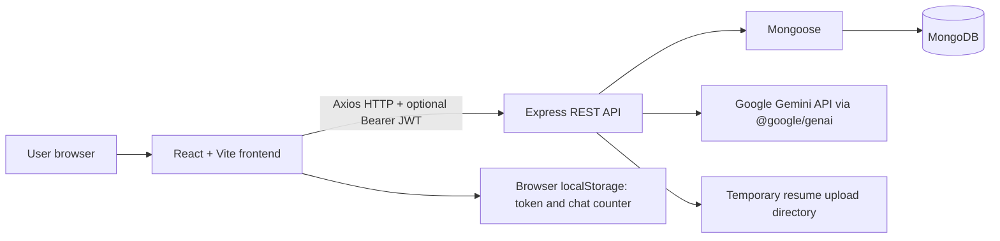

# Project Overview

## Scope confirmed from source

The repository contains a React/Vite frontend and an Express backend using MongoDB through Mongoose. The application provides account registration and login, profile capture, career and learning-path lookup, Gemini-backed career recommendations and chat, PDF resume analysis, skill-gap analysis, resume-analysis history, and a dashboard.

The backend starts from `backend/server.js`; the frontend mounts a React `BrowserRouter` in `frontend/src/main.jsx`. The root README contains only the repository identifier, so it does not provide additional project requirements or operating instructions.

## Confirmed technologies

| Area | Evidence-based technology |
|---|---|
| Frontend | React 19, React Router, Axios, Vite, Lucide React |
| Backend | Node.js, Express 5, CORS, dotenv |
| Database | MongoDB with Mongoose |
| Authentication | bcryptjs and JSON Web Tokens |
| AI | `@google/genai` / `GoogleGenAI` |
| Resume upload/processing | Multer and `pdf-parse` |

## Main user journey

1. A user registers, then logs in to receive a one-day JWT.
2. The frontend stores the JWT in browser `localStorage` and guards application routes based on token presence.
3. The user creates or updates a personal profile.
4. Profile information supports AI recommendations, AI chat, and the AI-selected target used by skill-gap analysis.
5. The user can upload a PDF for analysis, view stored analysis history, view learning/career records when available, and use the dashboard.

## High-level architecture

The diagram represents code paths, not a verified deployment topology. Environment values and infrastructure hosting require confirmation.
