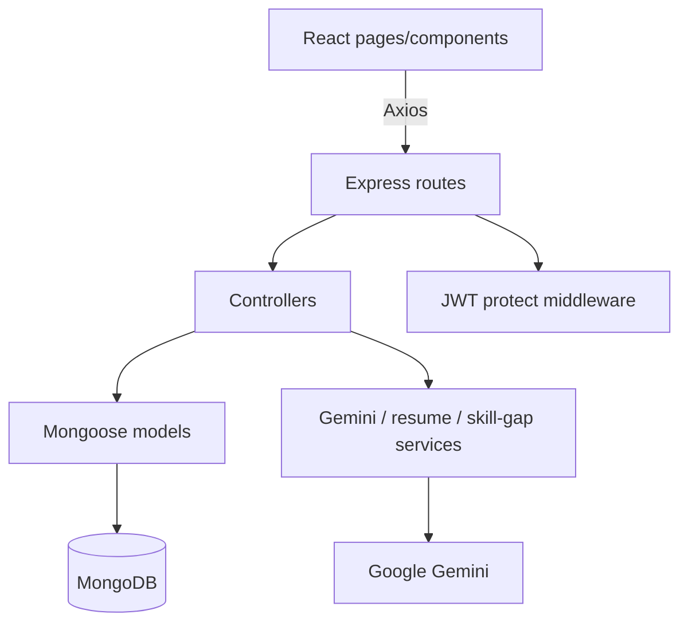
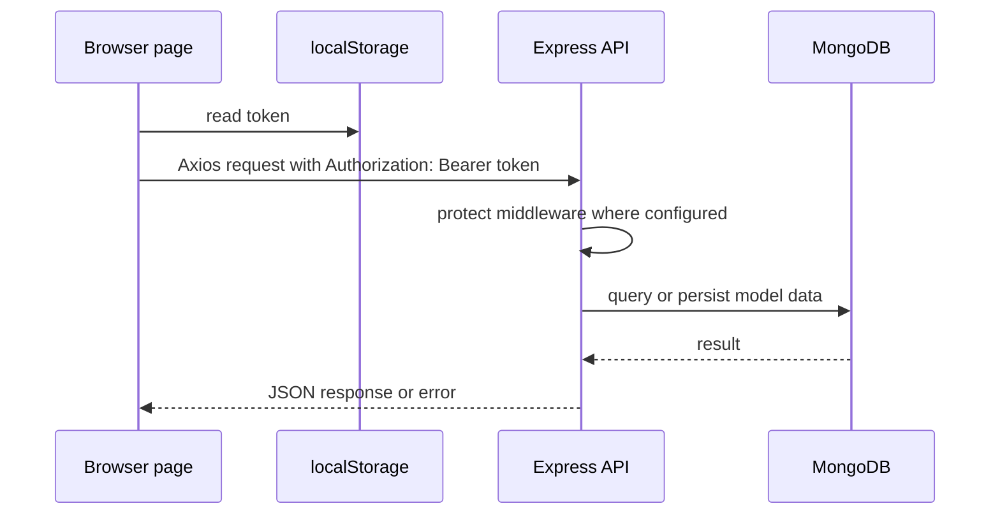

# System Architecture

## Backend composition

`backend/server.js` configures CORS and JSON parsing, calls the database connector, then mounts route groups under `/api`. Controllers coordinate models and services. Mongoose models define persistent collections. Gemini and calculation helpers sit in `backend/services`.

## Frontend–backend request flow

Some frontend pages send an Authorization header even though the matching backend career and learning-path routes do not currently apply the protect middleware. This is an implementation observation, not a change request.

## Route groups

`/api/auth`, `/api/profile`, `/api/careers`, `/api/learning-path`, `/api/dashboard`, `/api/ai`, `/api/chat`, `/api/ai-chat`, `/api/resume`, and `/api/skill-gap` are mounted by the server. A root `GET /` returns a plain status string.

## Data boundaries

User, Profile, ResumeAnalysis, and SkillGapAnalysis have explicit user references. Career and LearningPath are independently queried by string fields; no code-based relationship to User or to one another is defined. See `05-database-design.md` for the modeled relationships.
