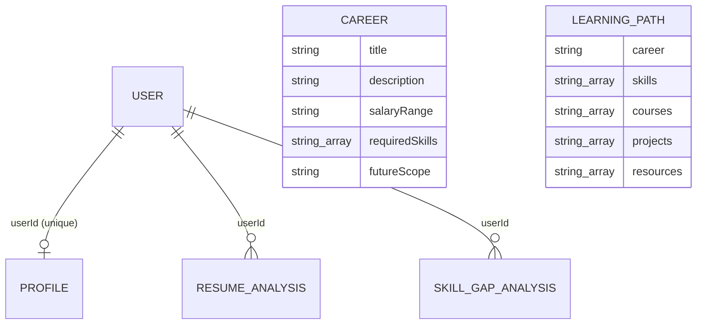

# Database Design

## Models and fields

| Collection/model | Fields evidenced by schema | Required / constraints | Timestamps |
|---|---|---|---|
| `User` | `name:String`, `email:String`, `password:String` | all required; `email` unique | `createdAt`, `updatedAt` |
| `Profile` | `userId:ObjectId`, `name:String`, `email:String`, `interest:String`, `skills:[String]`, `education:String`, `careerGoal:String` | `userId` required and unique; references `User` | none declared |
| `Career` | `title:String`, `description:String`, `salaryRange:String`, `requiredSkills:[String]`, `futureScope:String` | none declared | none declared |
| `LearningPath` | `career:String`, `skills:[String]`, `courses:[String]`, `projects:[String]`, `resources:[String]` | none declared | none declared |
| `ResumeAnalysis` | `userId:ObjectId`, `atsScore:Number`, `summary:String`, ten string-array result fields | `userId` required; references `User` | `createdAt` only |
| `SkillGapAnalysis` | `userId:ObjectId`, `career:String`, `currentSkills:[String]`, `missingSkills:[String]`, `readinessScore:Number`, `learningPriority:[String]` | `userId` and `career` required; `userId` references `User` | `createdAt` only |

`ResumeAnalysis` arrays are: `strengths`, `weaknesses`, `missingSkills`, `careerMatches`, `recommendedCertifications`, `recommendedCourses`, `portfolioProjects`, `resumeImprovements`, `interviewPreparation`, and `next30DaysPlan`.

## Relationships

No schema reference connects `Career` and `LearningPath`, although controllers use career-name strings for lookups. No indexes beyond the Mongoose `unique` declarations were found. Actual MongoDB index creation/state: **Requires confirmation**.

## Persistence behavior

Profile writes use `findOneAndUpdate` with upsert keyed by `userId`, producing one profile per user in normal operation. Resume and skill-gap calls create a new analysis document each time. Career and learning-path endpoints are read-only in this source. Population/seed mechanism for their collections: **Requires confirmation**.
