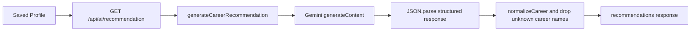

# AI / Gemini Integration

## Library and model

Gemini access uses `@google/genai`, specifically `GoogleGenAI` and, for structured calls, `Type`. Both `geminiService.js` and `resumeAnalyzerService.js` instantiate the client with `GEMINI_API_KEY`. The configured model is `GEMINI_MODEL` when supplied; otherwise it defaults to `gemini-3.5-flash`.

## Career recommendation flow

The career prompt includes name, education, interest, skills, and career goal. It asks for exactly three items, with canonical career titles, numeric `matchPercentage`, `reason`, `missingSkills`, and `suggestedLearningRoadmap`.

The service requests `application/json` and supplies a response schema. It parses `response.text` (with fallback expression for an output content value) via `JSON.parse`, normalizes career strings to the canonical set, and filters unrecognized careers. The code does not perform separate post-parse validation of array count, numerical range, or every field beyond Gemini response-schema configuration and career normalization.

## AI chat

`generateChatResponse` builds a profile-aware career-advisor prompt plus the user message, requests unstructured generated content, and returns trimmed text. It asks for professional, career-relevant, concise practical advice (150–300 words). `/api/ai-chat` returns `{ response }`; `/api/chat` returns `{ reply }`. The frontend calls only `/api/ai-chat` in the inspected source.

## Error handling

Missing API configuration and Gemini request failures are wrapped with code `AI_SERVICE_UNAVAILABLE`. The service classifies likely failure categories for logging (authentication, permissions, model not found, quota/rate, network, or general request failure) without exposing the underlying credential. Controllers map this condition to 503 in the recommendation, AI-chat, resume, and skill-gap flows. The alternate `/api/chat` controller instead returns a generic 500 for all failures.

## AI-dependent modules

Career recommendation, AI advisor chat, resume analysis, and skill-gap analysis all depend on Gemini. Skill-gap analysis uses Gemini only to select a recommended career; its skill comparison itself is local deterministic logic.

Prompt effectiveness, model availability in the target account, output accuracy/bias, and production safety evaluation: **Requires confirmation**.
