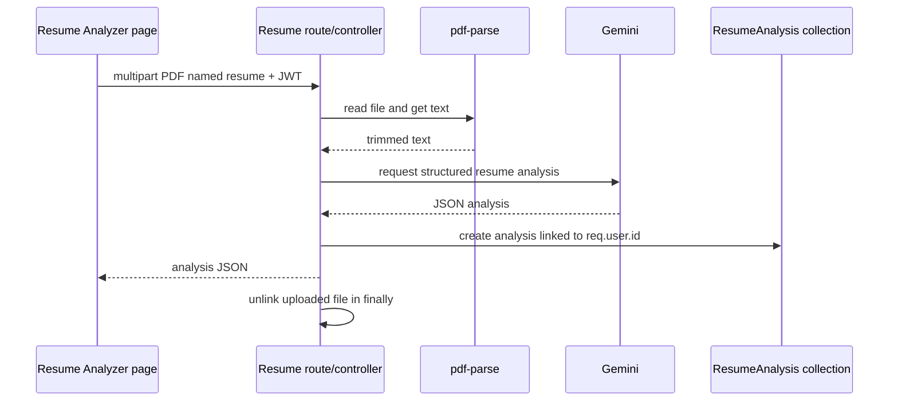

# Resume Analyzer

## Purpose and user interaction

The Resume Analyzer page accepts a user-selected or dragged PDF, shows upload progress while posting it, then displays an ATS score, summary, and ten analysis sections. `ResumeHistory.jsx` retrieves saved records and presents date, ATS score, and first career match.

## Upload and validation

Frontend `ResumeAnalyzer.jsx` accepts only MIME type `application/pdf` and rejects files over 5 MB before submission. It creates `FormData` with field name `resume` and sends `POST /api/resume/analyze` with a bearer token. The backend repeats validation through Multer: disk storage at `backend/uploads/resumes`, a sanitized timestamp-prefixed original filename, 5 MB file limit, and PDF MIME-type filter. Missing file, unreadable text, invalid type, and oversize errors are handled with 400 responses.

## Processing flow

`extractResumeText` reads the temporary file, uses `PDFParse.getText()`, trims text, and destroys the parser in a `finally` block. After the controller response path completes, it attempts to remove the temporary upload file in its own `finally` block.

## Gemini output and persistence

The resume service requests JSON with required `atsScore`, `summary`, `strengths`, `weaknesses`, `missingSkills`, `careerMatches`, `recommendedCertifications`, `recommendedCourses`, `portfolioProjects`, `resumeImprovements`, `interviewPreparation`, and `next30DaysPlan`. The controller stores the returned fields with the authenticated `userId` in `ResumeAnalysis` and returns the analysis to the caller. `GET /api/resume/history` filters by `userId` and sorts descending by `createdAt`.

The schema intentionally stores results, not the PDF filename or raw text. Consequently, the history UI's `item.fileName` falls back to “Resume analysis” under the observed model. PDF storage retention after normal processing is designed to be temporary; actual cleanup success and backup retention: **Requires confirmation**.
