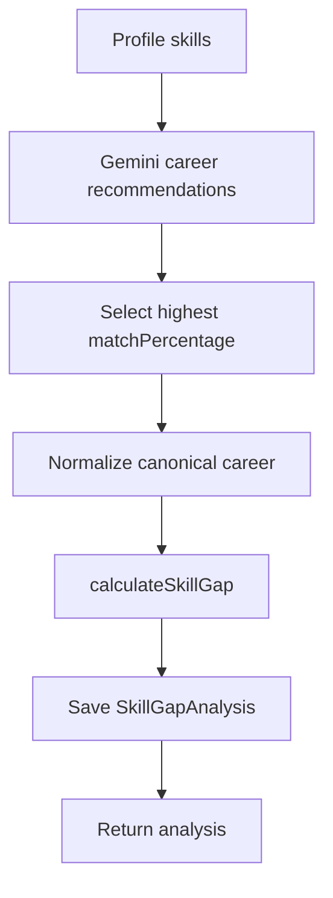

# Skill-Gap Analysis

## Purpose and interaction

The protected Skill Gap page fetches one analysis on mount and displays the selected career, readiness percentage, current skills, missing skills, and ordered learning priorities. A missing profile gives the user a link to the Profile page; other failures offer reload/retry behavior.

## Backend process

`getSkillGap` loads the current profile, calls `generateCareerRecommendation`, reads the recommendations array, sorts a copy by numeric `matchPercentage` descending, and takes the first career. It calls `normalizeCareer`; unsupported/empty recommendations result in 422 responses. No user-selected career parameter is accepted by this endpoint—the career is chosen from the current Gemini recommendation.

## Required/current/missing skills and readiness

`skillGapService.js` has local required-skill lists for eight canonical careers: Software Engineer, Data Scientist, AI/ML Engineer, Cloud Engineer, Cybersecurity Analyst, Web Developer, DevOps Engineer, and Database Administrator. It accepts several aliases. Current skills are the profile skill array after falsy items are filtered. For comparison only, both known and required skills are lowercased and trimmed.

`missingSkills` contains required skills absent from that normalized known-skill set. `readinessScore` is `round((required count - missing count) / required count * 100)` (or `0` with no required list). `learningPriority` is exactly the `missingSkills` array; no separate prioritization/ranking algorithm exists in the source.

## Persistence

Each successful request inserts a `SkillGapAnalysis` containing `userId`, canonical career, current skills, missing skills, readiness score, and learning priority. There is no observed endpoint to retrieve prior skill-gap analyses; the dashboard calls this calculation endpoint again rather than retrieving a history.
